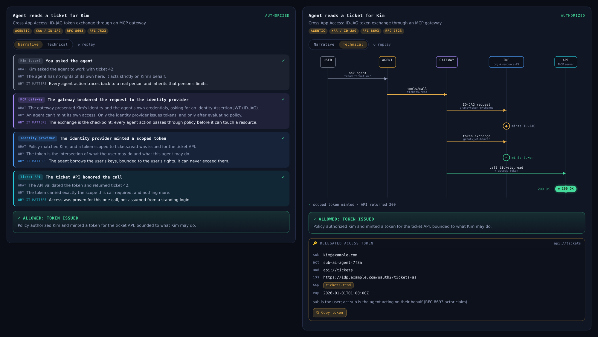

# Token Journey

**See an auth flow the way it actually happened: as a plain-language story, and as an animated
sequence diagram where the token travels between the systems that mint, narrow, and refuse it.**



Token Journey began as the "token journey" drawer in a hands-on lab about securing AI agents
with Okta, where attendees watch an agent's request go through a Cross App Access (ID-JAG)
exchange and see exactly where policy said yes or no. People kept asking to use it for their own
flows, so the viewer was pulled out, made protocol-agnostic, and documented here.

It works for any OAuth 2.0 / OpenID Connect flow: agent delegation, token exchange (RFC 8693),
authorization code + PKCE, client credentials, MCP authorization discovery, or something custom.

## How it works

```
 your code / a test / a hand-written file          the browser
 ┌──────────────────────────────────────┐   JSON   ┌──────────────────────────────┐
 │ recorder (Python or JS)              │ ───────► │ viewer/token-journey.js      │
 │   or an adapter for your app's shape │  trace   │   Narrative  |  Technical    │
 └──────────────────────────────────────┘          └──────────────────────────────┘
```

1. **A trace** (one JSON document) describes the flow: the actors, the ordered steps, the tokens,
   and the outcome. Format: [docs/journey-format.md](docs/journey-format.md).
2. **The viewer** plays any trace. It knows nothing about any identity provider, so adapting to a
   new flow never means touching rendering code.
3. **Recorders** (Python and JavaScript, standard library / zero dependency) let the code that
   really runs a flow emit a trace as it goes. They redact JWT signatures by default.

## Try it in 30 seconds

```bash
git clone https://github.com/joevanhorn/token-journey && cd token-journey
python3 -m http.server 8000
# open http://localhost:8000/examples/
```

The gallery has seven example flows, and a playground where you can paste or drop your own trace.

### Record a real sign-in against your own identity provider

```bash
export TJ_ISSUER=https://YOUR-ORG.okta.com/oauth2/default   # any OIDC issuer: Okta, Auth0, Entra ID, Keycloak...
export TJ_CLIENT_ID=...   # a client allowing redirect URI http://localhost:8765/callback
python3 examples/live-oidc/app.py
# open http://localhost:8765 and sign in
```

It runs authorization code + PKCE for real, and optionally an RFC 8693 token exchange and an API
call (see the [script's header](examples/live-oidc/app.py) for settings). Errors become a "deny"
journey with the provider's verbatim error, which is often the most useful view of all.

## Embed it

```html
<link rel="stylesheet" href="viewer/token-journey.css">
<div id="journey"></div>
<script src="viewer/token-journey.js"></script>
<script>
  fetch('my-journey.json').then(r => r.json())
    .then(j => TokenJourney.render(document.getElementById('journey'), j, { view: 'narrative' }));
</script>
```

Options, theming, and the controller API: [docs/viewer-api.md](docs/viewer-api.md).

## Record from your code

```python
from token_journey import Journey   # pip install ./recorder/python

j = Journey("Orders calls Billing for the user", subtitle="RFC 8693 token exchange")
j.actor("orders", "Orders service", kind="service")
j.actor("as", "Authorization server", short="AS", kind="idp")
j.actor("billing", "Billing API", kind="resource")
j.message("orders", "as", "token exchange", tone="info", token="subject + actor",
          story=Journey.story("Orders asked to act for the user",
                              what="...", why="...", matters="..."))
j.event("as", "mints delegated token", tone="ok", token="act=orders")
j.message("orders", "billing", "POST /charges", tone="ok", token="delegated token")
j.allow("Billing accepted a token naming both the user and Orders.")
j.token("Delegated token", raw=access_token)   # signature redacted automatically
j.save("journey.json")
```

The JavaScript recorder ([recorder/js](recorder/js/journey-builder.js)) has the same API and
produces identical output (a test enforces this).

## Adapt it to your flow

[docs/adapting.md](docs/adapting.md) is a step-by-step guide with three routes, from least to most
integration:

| Route | When | Effort |
|---|---|---|
| Hand-write a trace | Docs, slides, training, explaining a design | Minutes |
| Record from your code | You run the flow in a backend, gateway, or test | An hour |
| Write an adapter | Your app already returns flow data in its own shape | An afternoon |

[adapters/okta-xaa-lab.js](adapters/okta-xaa-lab.js) is a complete worked example of the third
route: it converts the original lab's backend responses into traces.

## Repository layout

| Path | What it is |
|---|---|
| `viewer/` | The renderer: `token-journey.js` + `token-journey.css`. Zero dependencies. |
| `schema/journey.schema.json` | JSON Schema for traces (editor autocompletion, CI validation). |
| `recorder/python`, `recorder/js` | Builders that emit traces from real code. |
| `adapters/` | Converters from an existing app's response shape to traces. |
| `examples/` | Gallery + playground, example traces, and the live OIDC recorder. |
| `docs/` | Format reference, adapting guide, viewer API, architecture. |
| `tests/` | Unit, parity, end-to-end (against a mock IdP), and browser render tests. |

## Security

The viewer is a teaching and debugging aid. It decodes tokens but **never verifies them**, so never
use it to make trust decisions. It renders every string with `textContent` (a hostile trace can't
inject markup) and only links to http(s) URLs. Recorders redact JWT signatures by default so traces
can be shared, but claims are still personal data: don't publish traces from production users.
See [SECURITY.md](SECURITY.md).

## Development

```bash
npm test                          # validator, decoder, examples, adapter, Python/JS parity (Node 18+)
python3 -m unittest discover tests   # recorder unit tests + live OIDC end-to-end against a mock IdP
python3 tests/render_smoke.py     # every example x both views x both themes in Chromium (needs Playwright)
```

Contributions welcome: see [CONTRIBUTING.md](CONTRIBUTING.md). Licensed under Apache 2.0.
